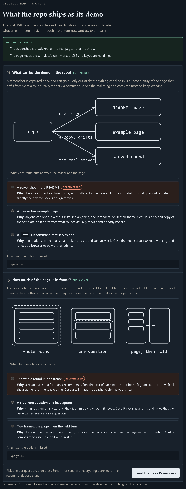

# visual-grilling

Grill a decision on a page the reader answers on.

An agent maps a decision as a tree, asks the whole frontier as **one local page**, and
**holds its turn open** until the reader submits. The answers come back as the reason the
turn resumed, so the reader never has to type a chat message as well, and each branch is
shown with what taking it costs rather than argued in prose.

Ships as a **Claude Code plugin** (skill and Stop hook installed together) and as a **Codex
install** (the same hook, merged into `~/.codex/hooks.json`).



*One round, photographed as it was served: the question set the agent could ask without
guessing, a recommendation first each time with what the alternative costs, and a diagram
where the choice is easier to see than to read. The answers to that round came back as the
reason its turn resumed.*

## How a round works

1. **Map the tree.** The subject becomes a decision tree; the *frontier* is every decision
   whose prerequisites have been answered — the questions askable now without guessing.
2. **Serve the page.** One page carries the whole frontier: a heading per question, the
   recommended option first with its reasoning, and beside every option what taking it costs.
   The page is served on loopback, so the reader answers in a browser and never pastes.
3. **Hold the turn.** A Stop hook keeps the turn open, watches that round's answers, and
   resumes the turn with them the moment the page is submitted.
4. **Move the frontier.** Answers open new questions and reopen settled ones. Repeat until
   the frontier is empty; the page then carries the map, and the work starts once the reader
   confirms it.

## Features

- **Whole-frontier rounds** — every askable question at once, so a round is one reading
  rather than a drip of single questions.
- **A turn that waits** — the reader's submission resumes the agent's turn; nothing needs
  polling, and no "let me know when you've answered" step exists.
- **Controls matched to the answer** — radio list for one choice, checklist for several, a
  named scale for a judgement, an orderable list, and a free-text field on every question.
- **Pictures where they help** — inline SVG drawn to show the difference between branches.
- **Session-scoped rounds** — a round belongs to the session that armed it: each session gets
  its own pointer, the round records its owner, and the hook acts only on a round it can
  prove is that session's own.
- **Durable answers** — delivery retires the round marker and leaves `answers.json` in place,
  which is the copy an agent reconciles from if delivery ever goes astray.
- **A round owns its port and its page** — the operating system assigns the loopback port,
  and each served page carries that round's token, so a submission is always traceable to the
  page that produced it.
- **Two harnesses, one hook** — Claude Code and Codex both expose a `Stop` hook with the same
  input fields and the same `{"decision": "block", "reason": …}` continuation, so one hook
  file serves both.
- **Self-diagnosis** — `doctor` reads the hook, the server, the manifests, both harness
  registrations and every round on disk, and names the fix for anything it finds.

## Install — Claude Code

```
claude plugin marketplace add newstonnate-png/visual-grilling
claude plugin install visual-grilling@visual-grilling
```

The plugin's `hooks/hooks.json` registers the Stop hook as part of that install; nothing else
to wire. Confirm with `claude plugin details visual-grilling`:

```
Component inventory
  Skills (1)  visual-grilling
  Hooks (1)  Stop  (harness-only — no model context cost)
```

Plugin hooks register when a session loads the plugin, so the first session after installing
is the first one they guard.

## Install — Codex

```
python bin/visual-grilling.py install --harness codex
```

This merges a `Stop` hook into `~/.codex/hooks.json` alongside any hooks already there, and
running it twice leaves one entry. Then approve it in Codex:

```
/hooks      # trust the Stop hook
```

Codex records trust against a hook's bytes and skips an untrusted hook, so a later change to
`hooks-handlers/stop-hook.py` is re-reviewed. `codex/README.md` covers what Codex supports
here and the Agent Plugins packaging for its own plugin route.

## Quick start

```
Grill me on how the cache layer should work before I start building it.
```

The agent maps the tree, serves the page on loopback and opens it. Answer it — or send with
everything blank to let the recommendations stand — and the turn resumes by itself with the
answers. The next round carries what they opened up.

## Mechanics

A round lives in one directory, named by `--dir`: it holds the page for that round, the
answers, the URL, and — under Claude Code — the record that arms the hook. The server is run
from the plugin and told where the round is, so one copy serves every round.

| In the round directory | |
|---|---|
| `page.html` | the round's questions, copied from `template/page.html` and filled in |
| `answers.json` | what the reader submitted, written by the server and kept after delivery |
| `url.txt` | the loopback URL the round is served on |
| `round.json` | the armed record: owner key, protocol, URL, process id |

| Program | |
|---|---|
| `template/serve.py` | serves the page, injects the round's token, accepts exactly one submission, prints the URL, round id and protocol, then the answers |
| `hooks-handlers/stop-hook.py` | derives the session's key, finds that session's round, requires the recorded owner to match, waits for `answers.json`, and resumes the turn with the answers |

Both files carry a `PROTOCOL` constant describing the round's shape; they must agree.

The server prints three lines at startup — the URL, the round id shown in the tab title, and
the protocol — and one line on collection: `ANSWERS ARRIVED: {…}`. The hook prints the block
JSON Claude Code and Codex both read.

## Diagnosis and doctoring

```
python bin/visual-grilling.py status          # what is installed, where, harness by harness
python bin/visual-grilling.py doctor          # check everything, name every fix
python bin/visual-grilling.py doctor --fix    # …and repair this toolkit's own scratch state
```

`doctor` exits `0` only when the toolkit is whole. It checks that the hook, the server and the
page are present and compile; that the `PROTOCOL` constants agree; that `hooks/hooks.json`
registers a Stop hook whose command resolves at the plugin root; whether a Stop hook in
`~/.claude/settings.json` also names this toolkit; every round on disk with its owner,
protocol and age; scratch directories holding their own copy of the server; and the Codex
registration with its re-review reminder.

When a round does not come back, run `doctor` first: it separates a round nobody armed, a
round whose session has exited, and a round whose answers are sitting in `answers.json`
waiting to be read.

The same checks run against the real server and hook as a suite — `python
tests/test-isolation.py`, 22 checks covering two sessions, two ports, a foreign submission,
an ownerless round, the doctor and both manifests. It is the gate for any change here.

## Layout

```
.claude-plugin/plugin.json        Claude Code plugin manifest
.claude-plugin/marketplace.json   the marketplace, so the repo installs itself
plugin.json                       Agent Plugins manifest, for Codex's plugin route
.agents/plugins/marketplace.json  Codex's marketplace file
skills/visual-grilling/           the skill: the interview, the page, the round
  template/serve.py               serves the page, collects exactly one submission
  template/page.html              the page to copy and fill in for a round
hooks/hooks.json                  the Stop hook, registered by the Claude Code install
hooks-handlers/stop-hook.py       holds the turn, delivers the answers, never deletes them
bin/visual-grilling.py            status, doctor, install
codex/README.md                   what Codex supports here, and what it cannot
docs/demo-round.png               the screenshot above: one round as it was served
tests/test-isolation.py           the checks
```

## Requirements

Python 3.8 or newer on `PATH` as `python`. Standard library only — no packages to install.
Loopback only: the page is served on `127.0.0.1` and nothing is exposed to a network.

## Contributing

`AGENTS.md` holds what a session working in this repo must do before changing anything: run
the checks first, keep the two `PROTOCOL` constants in step, never delete `answers.json` on
delivery, never copy the server, and validate both manifests with
`claude plugin validate <path> --strict`. Every change updates the Markdown it invalidates in
the same change.

## License

MIT
